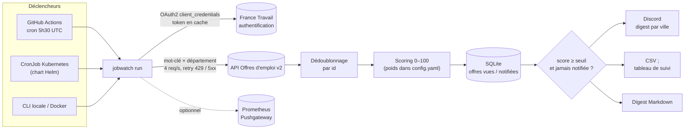

# jobwatch

[](https://github.com/CalixteManaud/jobwatch/actions/workflows/ci.yml)
[](https://htmlpreview.github.io/?https://github.com/CalixteManaud/jobwatch/blob/python-coverage-comment-action-data/htmlcov/index.html)
[](https://github.com/CalixteManaud/jobwatch/actions/workflows/daily.yml)

[](LICENSE)

Bot qui surveille chaque matin les **nouvelles offres CDI DevOps / Cloud / Run** publiées sur
France Travail, les **classe par pertinence** pour un profil junior, et livre :

- un **digest Discord** groupé par ville, trié par score, avec les raisons de chaque score ;
- un **CSV** prêt à coller dans un tableau de suivi de candidatures ;
- un **digest Markdown** archivé à chaque run.

C'est aussi un projet vitrine DevOps : code typé et testé, CI/CD, image Docker durcie, chart Helm
et déploiement Kubernetes local.

---

## Sommaire

- [Le problème](#le-problème)
- [Architecture](#architecture)
- [Démarrage rapide](#démarrage-rapide)
- [Commandes](#commandes)
- [Scoring](#scoring)
- [Sorties](#sorties)
- [Déploiement](#déploiement)
- [Choix techniques](#choix-techniques)
- [Limites](#limites)
- [Développement](#développement)

## Le problème

Chercher un premier CDI DevOps, c'est relancer chaque matin la même dizaine de recherches
(« devops », « sre », « ingénieur de production »…) sur plusieurs villes, retomber sur les mêmes
annonces et trier à la main les offres « senior 7 ans d'expérience » des vraies offres ouvertes
aux débutants.

jobwatch automatise cette routine :

1. **45 requêtes** par jour (9 mots-clés × 5 départements), uniquement en CDI ;
2. **dédoublonnage** global et **mémoire** des offres déjà vues / envoyées (SQLite) ;
3. **scoring 0–100 explicable** : bonus « débutant accepté » et technos de ma stack, malus
   séniorité, exclusion des alternances / stages / freelances ;
4. **un seul message** le matin, avec uniquement ce qui est nouveau et pertinent.

## Architecture



| Module | Rôle |
|---|---|
| `francetravail.py` | Client API : token OAuth2 en cache, throttling, retries, pagination `Content-Range` |
| `collect.py` | Une requête par couple (mot-clé, département), dédoublonnage, échecs partiels tolérés |
| `scoring.py` | Score 0–100 et liste des raisons, règles lues dans `config.yaml` |
| `store.py` | État SQLite : `offers(id, first_seen, score, notified, payload)` |
| `discord.py` / `exporters.py` | Digest Discord (embeds découpés), CSV, Markdown |
| `pipeline.py` / `cli.py` | Orchestration du run, commandes typer, codes de sortie |
| `metrics.py` | Résumé du run et push Prometheus optionnel |

## Démarrage rapide

### Prérequis

- Linux ou **WSL 2 (Ubuntu)** sous Windows, `git`, `make`
- [uv](https://docs.astral.sh/uv/) (installe aussi Python 3.12) :
  `curl -LsSf https://astral.sh/uv/install.sh | sh`
- Optionnel : Docker, puis `kind`, `kubectl` et `helm` pour la démo Kubernetes

### 1. Identifiants France Travail

1. Créer un compte sur [francetravail.io](https://francetravail.io) (espace développeur).
2. **Mes applications → Créer une application** (nom libre, ex. « jobwatch »).
3. Dans l'application, **s'abonner à l'API « Offres d'emploi v2 »**.
4. Récupérer l'**identifiant client** et la **clé secrète** de l'application.

### 2. Webhook Discord

Sur votre serveur : **Paramètres du salon → Intégrations → Webhooks → Nouveau webhook →
Copier l'URL du webhook**.

### 3. Configuration locale

```bash
git clone https://github.com/CalixteManaud/jobwatch.git && cd jobwatch
cp .env.example .env        # puis renseigner FT_CLIENT_ID, FT_CLIENT_SECRET, DISCORD_WEBHOOK_URL
make install                # uv sync + hooks pre-commit
```

Le fichier `.env` est ignoré par git. En pre-commit, gitleaks bloque tout secret qui se
glisserait dans un autre fichier.

### 4. Premiers runs

```bash
uv run jobwatch run --dry-run --since 7d   # vrais appels API, rien n'est envoyé ni mémorisé
uv run jobwatch run --since 7d             # premier vrai run : mémorise et envoie la semaine
uv run jobwatch run                        # ensuite, chaque jour (fenêtre 26h par défaut)
```

## Commandes

| Commande | Effet |
|---|---|
| `jobwatch run [--since 26h\|7d] [--dry-run] [--no-notify] [--min-score N] [--config PATH]` | Run complet |
| `jobwatch search "kubernetes" --dept 59 [--since 7d] [--limit 30]` | Recherche ponctuelle, tableau scoré (aucun état modifié) |
| `jobwatch sample [-k devops] [--dept 75] [--count 5]` | Enregistre une vraie réponse **anonymisée** dans `tests/fixtures/` et vérifie les champs attendus par les modèles |

Modes de `run` :

- `--dry-run` : appels API réels, digest affiché et fichiers écrits dans `out/`, mais **ni écriture
  SQLite ni Discord** ;
- `--no-notify` : état et fichiers mis à jour, pas de Discord ; les offres retenues partiront au
  prochain run normal.

Codes de sortie :

| Code | Signification |
|---|---|
| 0 | Succès, y compris échec partiel de certaines requêtes (loggé) |
| 1 | Toutes les requêtes de recherche ont échoué |
| 2 | Configuration absente ou invalide, mauvais usage |
| 3 | Authentification France Travail refusée |
| 4 | Envoi Discord en échec (ce qui est déjà parti est mémorisé, le reste repartira) |

Cibles `make` : `install`, `lint`, `format`, `test`, `run` (`SINCE=7d ARGS="--dry-run"`),
`docker-build`, `docker-run`, `docker-scan`, `helm-lint`, `kind-deploy`, `kind-job`,
`kind-delete`. `make help` les liste.

Variables d'environnement : `FT_CLIENT_ID`, `FT_CLIENT_SECRET`, `DISCORD_WEBHOOK_URL` (secrets),
`STATE_PATH` (défaut `./state/jobwatch.db`), `OUT_DIR` (`./out`), `CONFIG_PATH` (`./config.yaml`),
`PUSHGATEWAY_URL`, `LOG_LEVEL`, `LOG_FORMAT` (`json` ou `console`).

## Scoring

Toutes les règles et tous les poids sont dans [`config.yaml`](config.yaml), modifiable sans
toucher au code. La correspondance ignore casse et accents, porte sur des mots entiers et tolère
pluriel et féminin : « confirmé » couvre « confirmées », mais « expert » ne matche pas
« expertise » et « 5 ans » ne matche pas « 15 ans ».

| Règle | Points (défaut) |
|---|---|
| Base | 40 |
| `experienceExige = D` (débutant accepté) | +20 |
| « junior », « débutant », « jeune diplômé », « première expérience » (titre ou description) | +15 |
| Chaque techno de la stack (terraform, kubernetes/k8s, helm, aws, docker, ansible…) | +4, plafonné à +24 |
| « senior », « lead », « architecte », « expert », « confirmé », « manager », « 5/7/10 ans » dans le titre | −25 |
| « senior », « confirmé », « 5/7/10 ans » dans la description | −8 |
| `experienceExige = E` | −10, ou −25 si `experienceLibelle` ≥ 3 ans |
| Alternance, stage, freelance, portage, intérim (titre + champ `alternance`) | **exclue** |

Le score est borné à [0, 100]. Envoi à partir de **40** (`notify.min_score`, ou `--min-score`).
Priorité CSV : **1** si score ≥ 70, **2** si ≥ 50, sinon **3**.

Exemple : « Ingénieur DevOps Junior H/F », débutant accepté, Kubernetes + Terraform + AWS +
Docker + GitLab → 40 + 20 + 15 + 20 = **95**. À l'inverse, « Architecte Cloud Senior » avec
5 ans exigés tombe à **0**.

## Sorties

**Discord** : un message d'en-tête (nombre d'offres, répartition par ville), puis un message par
ville avec un embed par offre : titre cliquable, entreprise, ville, salaire si disponible,
score et 3 raisons principales. Le découpage respecte les limites Discord (10 embeds et 6000
caractères par message), les `429` sont respectés et aucune mention n'est autorisée. Sans nouvelle
offre, un message court « rien de neuf ».

**CSV** `out/jobwatch-AAAA-MM-JJ.csv` (UTF-8 avec BOM, séparateur `;`) :

```
Priorité;Entreprise;Ville(s);Poste à viser;Statut;Pourquoi / signal trouvé;Contact à chercher sur LinkedIn;Type;Date de contact;Relance le;Source;Notes
```

`Statut` vaut « À contacter », `Pourquoi` reprend les raisons du score, `Contact` vaut
« Talent Acquisition » + entreprise + ville, `Source` est le lien de l'offre. Les cellules qui
commencent par `=`, `+`, `-` ou `@` sont neutralisées (pas d'injection de formule).

**Markdown** `out/digest-AAAA-MM-JJ.md` : le même digest, archivable.

**Logs** : JSON sur stderr (structlog), secrets masqués. Fin de run :
`run.summary` (requêtes, offres récupérées, nouvelles, envoyées, durée). Avec `PUSHGATEWAY_URL`,
les mêmes compteurs sont poussés en gauges Prometheus (`jobwatch_run_*`,
`jobwatch_last_success_timestamp_seconds`).

## Déploiement

### GitHub Actions (recommandé)

| Workflow | Déclencheur | Contenu |
|---|---|---|
| [`ci.yml`](.github/workflows/ci.yml) | push, PR | ruff, mypy, pytest (couverture ≥ 80 %), helm lint, build Docker, scan Trivy (échec sur CRITICAL), push `ghcr.io/<owner>/jobwatch:<sha>` + `latest` sur `main` |
| [`daily.yml`](.github/workflows/daily.yml) | cron `30 5 * * *` + manuel (`since`) | `jobwatch run` ; CSV et digest publiés en artifacts du run |

1. Ajouter les secrets du dépôt : `FT_CLIENT_ID`, `FT_CLIENT_SECRET`, `DISCORD_WEBHOOK_URL`
   (*Settings → Secrets and variables → Actions*, ou `gh secret set`).
2. Lancer le premier run à la main avec `since = 7d` (*Actions → Daily digest → Run workflow*).
3. Les runs suivants partent seuls chaque matin.

L'état SQLite persiste entre les runs via `actions/cache` : clé unique `jobwatch-state-<run_id>`
et `restore-keys: jobwatch-state-`, donc chaque run repart du dernier état sauvegardé. Le workflow
a un groupe de `concurrency` pour éviter deux runs simultanés. Les actions sont épinglées par SHA,
avec des permissions minimales par job.

### Docker

```bash
make docker-build                      # image multi-stage, Python slim, utilisateur non-root
make docker-run SINCE=7d ARGS=--dry-run   # docker compose : .env + volumes state/ et out/
make docker-scan                       # Trivy en local
```

L'image n'a pas de `HEALTHCHECK` (c'est un job), son `ENTRYPOINT` est `jobwatch`, et compose la
lance en `read_only` avec `cap_drop: ALL`.

### Kubernetes (Helm + kind)

Le chart [`deploy/helm/jobwatch`](deploy/helm/jobwatch) déploie un **CronJob** :

- `schedule` et `timeZone` dans les values, `concurrencyPolicy: Forbid` ;
- secrets injectés par `envFrom` depuis un **Secret existant** (`existingSecret`). Le chart ne
  contient aucun secret, et `values.schema.json` refuse qu'on en mette un dans `env` ;
- PVC optionnel pour l'état (conservé au `helm uninstall`), ConfigMap optionnelle pour
  remplacer `config.yaml` ;
- `runAsNonRoot`, `readOnlyRootFilesystem` avec un `emptyDir` sur `/tmp`, `drop: ALL`, seccomp
  `RuntimeDefault`, pas de token de ServiceAccount, requests / limits.

Démo locale :

```bash
make kind-deploy   # crée le cluster kind, charge l'image, crée le Secret depuis .env, helm upgrade --install
make kind-job      # déclenche un run immédiat et suit les logs
make kind-delete
```

Hors kind : `kubectl create secret generic jobwatch-secrets --from-env-file=.env` puis
`helm install jobwatch deploy/helm/jobwatch`.

## Choix techniques

- **Python 3.12 + uv** : environnement reproductible (`uv.lock`), installation rapide en CI et
  en Docker.
- **httpx synchrone** : environ 50 appels par run, soit moins de 30 s à 4 req/s. L'asynchrone
  compliquerait le code et les tests sans rien gagner.
- **Throttling client** à 4 req/s (limite API : 10/s) et **tenacity** : backoff exponentiel sur
  429 / 5xx / erreurs réseau, en respectant `Retry-After`.
- **pydantic v2 tolérant** (`extra="ignore"`, `null` ramenés aux valeurs par défaut, date illisible
  ignorée) : une offre mal formée est ignorée et loggée, le run continue.
  `jobwatch sample` confronte les modèles à une vraie réponse anonymisée.
- **SQLite (stdlib)** : un fichier, transactionnel, et plus que suffisant pour quelques milliers
  d'offres. Le JSON brut de chaque offre est conservé pour pouvoir la recalculer plus tard.
- **Scoring déclaratif** : chaque point est justifié par une raison affichée dans Discord et dans
  le CSV, ce qui permet de régler les poids en connaissant leurs effets.
- **Codes de sortie explicites** : un job planifié qui échoue doit échouer franchement (CI rouge,
  Job Kubernetes en erreur). Un échec partiel reste un succès loggé.
- **Sécurité** : secrets en `SecretStr`, webhook jamais loggé (même par httpx), `.dockerignore`
  en liste blanche, gitleaks en pre-commit, image non-root scannée, Pod durci.
- **Tests sans réseau** : respx simule tous les appels HTTP et pytest-socket bloque toute
  connexion réelle. Le test d'intégration rejoue un run complet (token, 2 pages, 204), puis un
  second run pour vérifier que rien ne repart.

## Limites

- L'API ne pagine pas au-delà de **1150 résultats par requête**. Si une recherche dépasse ce
  plafond, un warning `search.truncated` est loggé. Avec une fenêtre de 26 h, ce n'est pas un
  problème en pratique.
- Le scoring repose sur des mots-clés : il peut se tromper sur une offre mal rédigée. Les raisons
  affichées servent justement à repérer ces cas.
- **GitHub Actions** : les crons peuvent partir avec du retard, et GitHub les désactive après
  60 jours sans activité sur un dépôt public. Une entrée de cache inutilisée 7 jours est purgée :
  si l'état est perdu, les offres de la fenêtre courante sont renvoyées une fois.
- Les départements 75 et 92 sont regroupés sous « Paris ». Une offre trouvée par plusieurs
  requêtes garde la zone de la première.
- Certaines offres France Travail n'ont pas de nom d'entreprise : elles apparaissent en
  « Entreprise non communiquée ».

## Développement

```bash
make lint        # ruff check + ruff format --check + mypy --strict
make test        # pytest + couverture (échec sous 80 %)
make format
uvx pre-commit run --all-files
```

```
src/jobwatch/     code de l'application (typé, mypy --strict)
tests/            tests unitaires + intégration (respx), fixtures JSON
deploy/helm/      chart Helm du CronJob
deploy/kind/      configuration du cluster de démo
.github/          CI, run quotidien, Dependabot
```

## Licence

[MIT](LICENSE)
